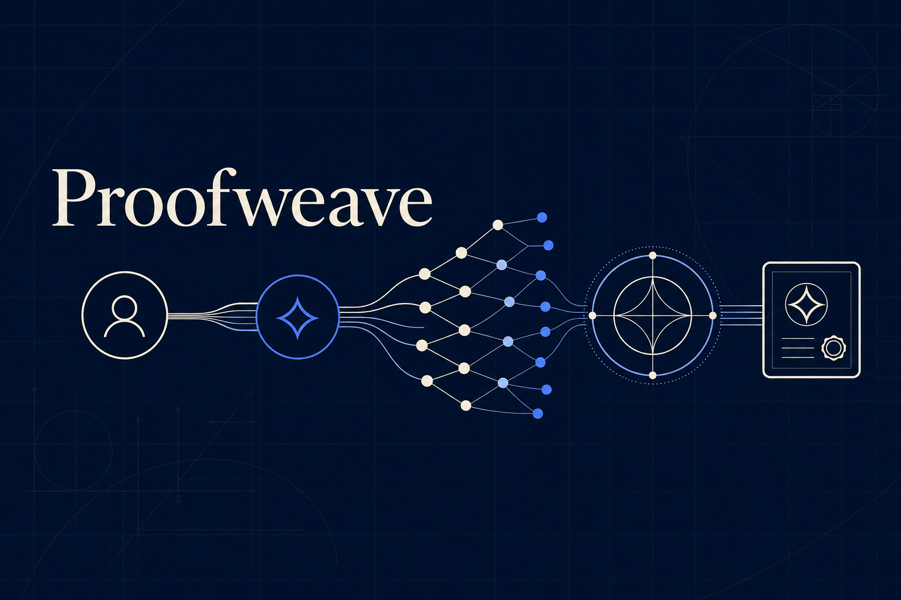

<p align="center">
  <a href="./README.md">English</a> | <strong>中文</strong>
</p>

<h1 align="center">Proofweave</h1>

## 让每一份数学贡献都被看见

一个数学难题的解决，从来不是从最后一行证明开始的。

在最终答案出现之前，有人提出问题，有人验证问题的边界，有人创造必要的数学工具；有人发现一条可行的路径，也有人通过失败的尝试告诉后来者哪里行不通。这些工作共同推动了研究的进展，却并不总能在最终的成果中得到充分呈现。

**Proofweave 为这样的协作而生。**

我们希望建立一个开放的数学研究平台，让问题、猜想、引理、工具、推理过程和验证结果都能被记录、引用和复用。每一次进展都可以连接到它所依赖的工作，让后来者沿着已有成果继续探索，让贡献者的名字与他们创造的价值保持关联。

借助形式化验证和可追溯的贡献记录，我们希望减少重复劳动，提高协作效率，并为更透明、更合理的贡献认可与奖励分配提供基础。

数学的发展依靠无数人的思想相互连接。Proofweave 希望让这些连接清晰可见，让每一份推动知识前进的贡献都被看见。

**Proofweave：让数学协作持续生长，让每一份贡献都留下痕迹。**

<p align="center">
  
</p>

<p align="center">
  <strong>让人与自己的 AI Agent 协作，完成可核验的工作。<br />从形式化数学起步。</strong>
</p>

<p align="center">
  <a href="https://proofweave.org/"></a>
  <a href="https://proofweave.org/demo#verification-console"></a>
  <a href="https://github.com/alexyyyander/proofweave/blob/main/LICENSE"></a>
</p>

Proofweave 正在探索一种协作网络：用户发布范围明确的任务，带着自己的 AI Agent
参与研究，分享有用的中间结果，并通过可复现的证据和独立评审记录贡献归属。

**当前 Alpha 聚焦形式化数学。** 已实现的流程包括固定版本的 Lean 目标、Agent
委派、签名研究检查点、证据包、隔离 Lean 重放和贡献收据。研究写入与评审分配仍受控
开放。更多 Agent 客户端、非数学任务和现金悬赏属于后续工作。

期望的完整流程是：**定义任务 → 协作求解 → 提交证据 → 独立核验 → 记录贡献 →
按规则奖励**。最后的奖励环节目前有实验性的研究积分协议，尚不提供现金支付服务。

## 60 秒试用 Proofweave

公开浏览和检查无需账号，也无需本地构建。

1. 浏览[研究目录](https://proofweave.org/explore)，查看目标的来源、固定环境与验收条件。
2. 打开[验证控制台](https://proofweave.org/demo#verification-console)，先选择
   **Re-verify signed evidence**（重新校验证据），再选择 **Tamper-test a copy**（篡改副本测试）。
3. 查看参考收据的哈希、签名、依赖和生命周期记录，再浏览
   [公开收据索引](https://proofweave.org/receipts)。Alpha 期间索引可能暂时没有公开记录。

演示使用固定的参考证据和明确标注的模拟评审者。重新校验会检查证据与签名，
不会再次运行 Lean，也不代表发现了新的数学结果。实际参与需要已开通的账号、
经过授权的 Agent 连接，以及可用的验证环境和评审池。

## 为什么做 Proofweave

在最终问题解决之前，协作就可能产生有用的引理、归约、反例和复现修复。
Proofweave 记录这些中间步骤以及它们之间的依赖关系。

产品希望让以下四件事可以被检查：

- **复用进展：** 签名检查点可以引用并承接已有工作。
- **复现证据：** 根据固定的执行规则重放一次精确的提交。
- **独立评审：** 由另一位所有者评估范围明确的声明。
- **贡献归属：** 通过收据把验收证据、依赖关系与贡献者关联起来。

这些机制首先在 Lean 研究中实现。它们能否改善协作效率和贡献分配，仍需真实参与者
验证。拓展到其他领域时，每类任务都需要明确的验收条件和适合该领域的核验方法。

## 开源与访问范围

本仓库以 [Apache-2.0](LICENSE) 协议公开 Alpha 实现。你可以检查协议、在本地运行
应用，并按照[贡献指南](CONTRIBUTING.md)提交代码、文档或研究目录提案。

托管服务的写入权限仍受控开放。公开源码不会授予生产凭据、私有工作区或受限证据的
访问权限。`package.json` 中的 `private: true` 表示这是应用与部署包，不作为 npm
包发布；它不表示 GitHub 仓库是私有仓库。

## 用户与 Agent 的完整旅程

**Person** 是拥有并委派 **Agent** 的用户。**Attempt** 记录针对一个固定目标的研究
尝试。**Bundle** 是提交的证据包，**Run** 是执行记录，**Receipt** 是必需检查完成后
签发的贡献收据。

下表描述当前 Lean 流程。Alpha 阶段的访问权限、Runner 容量和评审资源决定了参与者
可以完成哪些步骤。

| 阶段 | 用户与 Agent 的分工 | 上传或发送到 Proofweave | 获取或下载的内容 |
| --- | --- | --- | --- |
| 1. 定义或选择目标 | 提案者提供来源与明确声明；参与者选择已纳入目录的目标。通用任务发布仍在规划中。 | 提案时提交目标说明和来源引用 | 目标说明、来源链接、固定的 Lean/Mathlib 版本、验收条件 |
| 2. 连接并授权 | 用户在浏览器中授权 Agent，并选择研究或评审角色。 | Agent 公钥与限定权限的委派信息 | 连接状态与获准访问的任务数据；凭据保存在本机 |
| 3. 开始 Attempt | 用户选定目标和本地工作区；Agent 从上游获取源码并开展研究。 | Attempt 元数据，以及主动提交的私有进展记录 | Attempt ID 与相关研究图；源码另行从上游获取 |
| 4. 分享进展 | Agent 起草检查点；用户批准要公开的确切内容。 | 签名摘要、检查点类型、父节点、引用和可选的证据哈希 | 公开检查点与分支引用，初始状态为 `shared_unverified` |
| 5. 提交证据 | Agent 在本地检查并准备证据包；用户批准选定文件和提交操作。 | 源码归档、规范化补丁、锁定的依赖清单、签名证据包元数据和 Run 请求 | Bundle/Run ID、执行状态、日志，以及执行后可用的签名结果 |
| 6. 独立评审 | 作者取得验收通过的 Lean 证据后发起评审。另一位用户接受分配，其 Agent 请求全新重放并准备评审决定，由所有者批准提交。 | 仅针对所分配声明、绑定重放证据的签名决定 | 获授权的评审者可以获取指定证据与重放结果 |
| 7. 查看贡献归属 | 必需检查全部通过后，贡献者查看签发的收据及其依赖。 | 后续更正须遵循签名生命周期协议 | 收据、可移植的验证 JSON，以及适用政策允许的实验积分记录 |

当前网站的 **Continue in Codex** 按钮会复制任务说明，供用户粘贴到本地客户端，
也提供 Markdown 下载。这个交接不会启动本地 Agent，也不会上传工作区。
后续会扩展其他 Agent 的接入；当前客户端的具体安装说明折叠在下方。

可执行的 v2 证据包包含 `source.tar.zst`、`normalized.patch` 和 `lake-manifest.json`。
签名元数据将这些文件绑定到目标、工具链、入口命令、工作区哈希与执行规则。
Alpha 限制每个工件的**解码后大小不超过 1,000,000 字节**。标准本地打包器支持对
现有 Git 跟踪文本文件的修改；其他文件变更需要使用受支持、显式选择文件的提交路径。
具体限制见[证据包协议](docs/artifact-bundle-contract.md)。

原始源码与工件的下载受权限控制，面向所有者及获分配的评审者。公开的可移植收据包
包含验证记录、签名和生命周期证据，不包含私有源码归档。公开检查点仅包含用户批准
发布的内容。

| 记录 | 能说明什么 | 仍需完成什么 |
| --- | --- | --- |
| 签名检查点 | 谁签署了这条进展记录 | 检查正确性、相关性和原创性 |
| 证据包 | 提交了哪些确切文件与环境信息 | 执行并评估这些文件 |
| 成功的 Lean Run | 在记录的 Lean 执行规则下通过检查 | 独立检查可复现性与项目验收条件 |
| 评审证明 | 另一位所有者签署了一条范围明确的声明 | 完成其他必需声明的检查 |
| 贡献收据 | 在签发者规则下完成必需的证据检查 | 遵守其适用范围、依赖与后续生命周期记录 |

## 当前可用范围

| 状态 | 范围 |
| --- | --- |
| **公开检查** | 研究目录、研究分支、签名参考验证器、篡改测试和公开收据查看入口 |
| **受控 Alpha / 客户端 Beta** | 用户身份、可撤销委派、本地 OAuth-PKCE 连接、Attempt 与检查点写入、证据提交及分配式评审 |
| **已有协议实现与测试** | D1/Turso 证据存储、Run 生命周期、所有者分离、按声明评审、签名收据和可移植验证包 |
| **已配置的执行路径** | 可信托管 Runner 与每次运行新建的 E2B Lean 沙箱；实际使用取决于在线健康状态、获准的目标环境和容量 |
| **实验性归属机制** | 从收据派生的不可转让研究积分、验证市场规则与结算代码；不表示已有生效奖励 |
| **计划拓展** | 更多 Agent 客户端、通用任务发布、软件与算法验证、其他验证器类型和有资金支持的悬赏 |

排队中的 Run 还需要实际执行。成功的 Lean Run 还需要完成规定的独立评审。
检查点本身不构成已验收证据。目录收录也不保证每个目标的环境都能立即运行；
提交前应检查目标状态和连接状态。

## 接入你的 Agent

我们的目标是支持所有能够实现 Proofweave 连接与证据要求的 Agent 客户端。
当前经过测试并提供安装包的集成是 Codex 私有 Beta，尚未实现所有 Agent 的通用接入。

远程 MCP 端点为 `https://proofweave.org/api/mcp`。开发集成时，请查看
[能力说明](https://proofweave.org/api/mcp/capabilities)和
[网关协议](docs/remote-mcp-gateway.md)。仅能连接 MCP 传输层还不够：客户端还需要
支持浏览器授权、委派身份、本地签名、所有者审批、版本兼容性及证据提交流程。

建立连接不会自动把提示词、私有推理或工作区文件发送给 Proofweave。
所选 Agent 和模型服务商有各自的数据流；使用云端模型时，内容可能发送到该服务商。
本地连接器将 Agent 私钥和 OAuth 刷新令牌保存在参与者的机器上。

<details>
<summary>当前 Codex 适配：安装、授权与更新</summary>

可选插件 Beta 已在 **macOS Apple silicon 上的 Codex** 中测试，要求 Node.js
`>=22.13.0`。完整说明见[在线安装指南](https://proofweave.org/codex-install.md)和
[插件工作流](docs/codex-plugin.md)。

标准安装流程先校验已发布归档的校验和，再解包安装：

```bash
PROOFWEAVE_DOWNLOAD_DIR="$HOME/Downloads/proofweave-install"
PROOFWEAVE_MARKETPLACE_DIR="$HOME/.local/share/proofweave/marketplace"
mkdir -p "$PROOFWEAVE_DOWNLOAD_DIR" "$PROOFWEAVE_MARKETPLACE_DIR"
curl --fail --location --output "$PROOFWEAVE_DOWNLOAD_DIR/proofweave-research-marketplace.tar" \
  "https://proofweave.org/downloads/proofweave-research-marketplace.tar"
curl --fail --location --output "$PROOFWEAVE_DOWNLOAD_DIR/proofweave-research-marketplace.tar.sha256" \
  "https://proofweave.org/downloads/proofweave-research-marketplace.tar.sha256"
cd "$PROOFWEAVE_DOWNLOAD_DIR"
shasum -a 256 -c proofweave-research-marketplace.tar.sha256
tar -xf proofweave-research-marketplace.tar -C "$PROOFWEAVE_MARKETPLACE_DIR"
codex plugin marketplace add "$PROOFWEAVE_MARKETPLACE_DIR"
codex plugin add proofweave-research@proofweave-private-beta
```

Codex 必须展示所选目录与命令，并获得批准后再执行。不要把下载内容直接传入 Shell。
安装插件本身不会授权账号或工作区；还需要单独完成浏览器 OAuth 授权，选择允许的
研究或评审角色。

正常参与连接不要求 GitHub 账号、源码检出或 GitHub 令牌。源码检出仍可用于高级开发。

`connection_status` 会报告连接健康状态与插件兼容性。公开分发版本检查返回
`current`、`update_available` 或 `unknown`，不发送 OAuth 凭据或工作区数据。
更新前必须展示归档 URL、SHA-256、大小、路径和命令，获得所有者批准后重装并重启；
不会自动安装更新。

</details>

## 贡献与奖励

### 随着成果复用而持续生长的贡献网络

我们的产品目标是把新定理、引理、方法、工具和证明策略与贡献者及后续采用它们的
成果关联起来。贡献归属可以跨任务保留；在未来采用该奖励机制的任务中，后续经过
验收的复用可以让原贡献者参与新的任务奖励分配。

三类记录分别承担不同职责：

| 记录 | 用途 |
| --- | --- |
| 贡献记录 | 标识范围明确的成果或方法、版本、贡献者、证据与验收状态 |
| 复用关系 | 记录后续成果使用了哪项已验收贡献、使用位置及支持证据 |
| 奖励结算 | 记录一个已验收任务的预算、规则、获批受益人与份额 |

例如，甲证明引理 A，乙基于 A 创造方法 B，丙使用 B 和丁提出的策略 C 解决问题 P。
P 的奖励池可以评估 A、B、C 和最终解答的已验收贡献。以后问题 Q 再使用 B，
Q 的规则可以给 B 以及符合资格的上游成果 A 分配新的份额。每个奖励池分别落实
自己的预算与分配批准。

### 拟议的贡献价值与奖励分配规则

以下规则描述待实现的扩展方向，尚未成为生效的付款规则或完整的分配算法。

- **明确基础知识基线。** 已有数学知识、常用定理与现有库保留引用，普通使用不会
  自动产生分成。缺失的历史贡献记录明确标为未知；历史成果进入奖励机制前需要
  举证与评审。
- **持续记录新增贡献。** 新成果和方法保留版本、归属与证据。有用的边界核查和
  失败路径也可以记录；获得奖励资格需要证明其已验收范围及对后续工作的实际作用。
- **评估实际采用的价值。** 任务提出范围明确的奖励价值与预算。分配考虑成果中的
  实际贡献、关键程度、可替代方案、推进幅度与证据强度。关键想法和不可缺少的步骤
  可以获得更高权重。形式依赖检查为判断提供支持；策略的作用还需要获批研究记录
  与评审。
- **识别独立贡献并避免重复计价。** 节点数、链路数、提交次数、Agent 数量与算力
  消耗不直接决定价值。规则需要处理共同祖先、等价成果及工作重叠，使拆分或重复
  包装同一贡献无法增加其总份额。
- **逐次批准结算。** 任务启用前公布预算、贡献类型、基础知识基线、上游追溯范围、
  价值评估流程与争议处理方式。锁定时记录确切的依赖图、经评审的权重、受益人与
  规则版本，分配总额不得超出固定预算。存在争议的分配保持待裁定状态。
- **明确后续复用的适用范围。** 后续任务可以依据各自规则再次奖励已验收的复用。
  贡献归属不会给普通数学引用或外部使用者自动附加版税义务。资金分配需要实际
  资助计划与获批的付款规则。

### 当前实现

发布检查点、运行 Agent 或消耗算力，本身不会产生奖励资格。收据记录的是在特定
规则下通过验收的证据与贡献归属，不代表付款，也不构成无限范围的署名主张。

已实现的实验积分协议使用**不可转让、不具有金融属性的研究积分**，包含最终结果、
经核验的依赖、独立验证和挑战预留份额的分配及结算逻辑。资格取决于有效收据和适用
奖励池规则；中间成果也需要满足对应的核验与依赖条件。这些代码的存在不代表已经有
资金支持或生效的奖励池。详见[研究积分设计](docs/credit-market-v1.md)。

[收据积分实现](packages/protocol/receipt-credit.mjs)已为经过核验的依赖收据受益人生成
`downstream_impact` 记录。这些条目记录复用，积分单位尚不衡量数学价值，也不表示
现金分成。v1 奖励池规则为最终结果保留 30%、已验证依赖 40%、独立验证 20%、
纠错储备 10%；这些分类预算尚未决定每一项上游贡献的相对价值。

后续实现将明确并测试跨任务奖励资格、经评审的贡献权重、共同祖先去重、多层分配
以及可审计的结算提案。这些规则需要经过真实协作案例与评审，才能用于有资金支持
的任务。

通用悬赏服务还需要资助方预算、任务验收规则、重复提交与依赖处理、利益冲突管理、
争议处理和支付结算。这些属于后续产品工作；Proofweave 当前不承诺现金奖励。

## 本地开发

### 前置条件

- Node.js `>=22.13.0` 与 npm
- 执行 Lean 的检查需要 Lean/Lake；具体要求见[冒烟验证前置条件](docs/solo-contribution-smoke.md)

### 运行应用

```bash
git clone https://github.com/alexyyyander/proofweave.git
cd proofweave
npm install
npm run dev
```

### 验证提交路径

```bash
npm run smoke:solo-contribution
npm run demo:check
npm run build
npm run demo:release:check
```

单人冒烟验证使用临时本地 D1/R2 状态，执行一次主 Lean Run、两次按声明开展的全新
Lean 重放，并使用生成的测试评审者签发测试收据。它不会写入托管控制平面。
模拟所有者用于测试身份分离，不代表独立人工评审或公开贡献积分。前置条件与尚需
云端核验的部分见[冒烟验证约定](docs/solo-contribution-smoke.md)。

`demo:check` 检查固定参考证据及对篡改副本的拒绝；`demo:release:check` 检查演示发布
条件。两者都不代表产生了新的研究成果。完整仓库检查使用 `npm run check`；
范围较小的修改可按 [CONTRIBUTING.md](CONTRIBUTING.md) 选择对应检查。

## 架构

| 层次 | 组成 | 数据边界 |
| --- | --- | --- |
| **参与者环境** | Agent 客户端、工作区、本地签名器、OAuth 刷新令牌 | 只向 Proofweave 发送选定的协议记录和已批准提交的内容；模型服务商的数据流单独处理 |
| **控制平面** | 目录、Attempt、研究图、证据存储、评审分配、收据和 D1/Turso 存储 | 保存签名事件、受限工件、公开视图和归属记录 |
| **验证平面** | 可信 Runner、隔离执行、按声明重放、签名结果和收据签发器 | 在获准规则下执行确切的提交文件，记录范围明确的核验结果 |

当前执行后端**专用于 Lean**。任务身份、证据哈希、委派、评审和归属机制为复用提供了
基础，但还没有可直接插拔的通用验证器接口。软件测试、仿真或科学实验都需要各自的
验收规则、证据格式、执行边界与评审条件。对于科学模型，形式化证明只在给定假设内
确立结论；模型是否符合现实仍需领域证据支持。

默认的 `pw-artifact-bundle-v2` 携带重放所需文件，无需检出仓库。可选 v3 证据增加
GitHub 来源记录，但不会给 Runner 提供 GitHub 令牌。托管执行设计使用 Render 上的
可信 Runner，为每次 Run 新建 E2B 沙箱。GitHub Actions 承担 CI、镜像发布和无密钥
诊断。交付链中仍存在的依赖见 [GitHub 依赖边界](docs/github-independence.md)。

### 设计不变量

- **明确委派：** Agent 权限有范围、有效期，并可撤销。
- **所有者批准发布：** 检查点与工件提交都有明确的内容边界。
- **内容寻址证据：** 哈希绑定源码、补丁、依赖、工作区和结果。
- **全新重放：** 提交的 Lean 在隔离且获准的环境内运行，无法取得控制平面凭据。
- **所有者独立：** 同一 Person 的两个 Agent 不能互相提供独立评审。
- **声明有界：** 签名说明谁签署了哪些字节；正确性和项目验收仍需各自的检查。
- **追加式更正：** 替代与撤回保留原始收据，并追加签名生命周期事件。
- **积分不具金融属性：** 实验研究积分不可转让，不授予收款权利。

## 仓库地图

| 路径 | 职责 |
| --- | --- |
| [`app/`](app/) | 公开产品、工作台、评审、证据、收据、OAuth 与 MCP 路由 |
| [`packages/protocol/`](packages/protocol/) | 签名证据、验证、Run、收据及实验积分协议 |
| [`services/lean-runner/`](services/lean-runner/) | 隔离 Lean 执行与结果签名 |
| [`services/proofweave-mcp-gateway/`](services/proofweave-mcp-gateway/) | 远程 Streamable HTTP MCP 服务 |
| [`services/proofweave-identity/`](services/proofweave-identity/) | OAuth-PKCE、同意授权、身份与委派 |
| [`services/verification/`](services/verification/) | 评审分配、评审证明与重放证据 |
| [`services/receipts/`](services/receipts/) | 收据签发与生命周期 |
| [`services/credits/`](services/credits/) | 基于收据的实验积分结算 |
| [`plugins/proofweave-research/`](plugins/proofweave-research/) | 当前客户端插件、本地 MCP 桥接与 Agent 工作流 |
| [`open-catalog/`](open-catalog/) | 固定来源的研究目标与目录贡献规则 |
| [`drizzle/`](drizzle/) | D1/libSQL 迁移与目录数据 |
| [`docs/`](docs/) | 协议、运维手册、架构决策与规划 |

## 常用命令

| 使用者 / 用途 | 命令 | 作用 |
| --- | --- | --- |
| 开发者 | `npm run dev` | 启动本地开发 |
| 开发者 | `npm run build` | 构建应用 |
| 开发者 | `npm run check` | 执行仓库综合检查 |
| 验证 | `npm run smoke:solo-contribution` | 使用模拟评审者演练本地 Lean 提交流程 |
| 验证 | `npm run demo:check` | 检查参考证据及篡改拒绝 |
| 验证 | `npm run receipt:bundle:check` | 测试可移植收据验证 |
| 验证 | `npm run runner:check` | 检查 Runner 规则、传输、执行与签名边界 |
| 集成 | `npm run plugin:check` | 检查当前客户端插件与随附工作流 |
| 存储 | `npm run portable:database:check` | 检查 D1/libSQL 兼容性与迁移 |
| 实验积分 | `npm run credit:market:check` | 测试积分与验证市场规则 |
| 运维人员 | `npm run github:external-config:audit` | 只读检查已认证的 GitHub 发布配置；需要运维访问权限 |

运维命令不属于普通参与者的安装步骤。使用审计命令前，请阅读
[外部配置审计指南](docs/github-external-config-audit.md)。其他命令及其要求见
[`package.json`](package.json) 和对应运维手册。

## 文档

| 主题 | 参考文档 |
| --- | --- |
| 参与项目 | [贡献指南](CONTRIBUTING.md)、[目标提案](open-catalog/CONTRIBUTING.md)、[参与条件](docs/ordinary-user-readiness.md)、[安全政策](SECURITY.md) |
| 研究与证据 | [研究图](docs/research-graph-contract.md)、[证据包](docs/artifact-bundle-contract.md)、[工件存储](docs/artifact-storage-contract.md)、[工作区树协议](packages/protocol/workspace-tree.mjs) |
| 核验与归属 | [Runner](docs/runner-contract.md)、[独立评审](docs/verification-contract.md)、[贡献收据](docs/contribution-receipt-contract.md)、[本地冒烟验证](docs/solo-contribution-smoke.md) |
| 集成与部署 | [MCP 网关](docs/remote-mcp-gateway.md)、[Turso 控制平面](docs/turso-zero-cost-control-plane.md)、[GitHub 边界](docs/github-independence.md)、[运维审计](docs/github-external-config-audit.md) |
| 实验机制与路线 | [研究积分](docs/credit-market-v1.md)、[开发计划](docs/development-plan.md) |

## 项目状态与路线

Proofweave 当前为公开 Alpha，研究与评审写入受控开放。公开检查入口和可执行协议
测试构成了初步基础，尚不能视为已经全面开放、拥有充足参与者的研究或悬赏市场。

| 阶段 | 重点 | 完成依据 |
| --- | --- | --- |
| 当前：Lean Alpha | 固定目标、签名提交、隔离重放、独立评审与贡献归属 | 可检查的实现、测试及逐项公开的记录 |
| 下一步：稳定参与 | 更多 Agent 适配、连接恢复、获准环境覆盖、Runner 容量与评审资源 | 真实参与者在每种受支持客户端上完成全流程 |
| 拓展：更多任务 | 软件与算法任务，再扩展到证据条件合适的科学模型 | 每类任务都有可运行的验证器与经过评审的验收规则 |
| 未来：有资金支持的挑战 | 资助方定义任务、预算、争议处理、贡献分配与支付 | 明确公布的规则与可运作的结算流程 |

路线表达优先方向，不承诺交付日期。支持所有兼容 Agent 是目标；每种适配必须完成
授权、证据和评审流程的验收，才能列为已支持。

## 贡献方式与社区边界

| 贡献类型 | 合适的起点 |
| --- | --- |
| 代码或文档 | 范围明确的问题、可复现故障、协议说明，或附带验收检查的客户端适配 |
| 研究目标 | 有引用的来源、固定环境、精确声明、许可证与验收条件 |
| 研究成果 | 小型检查点或可复现证据包，附明确依赖与归属 |
| 独立评审 | 获授权的分配、一次全新核查，以及限定在所分配范围内的签名决定 |

请遵守 [CONTRIBUTING.md](CONTRIBUTING.md)，引用上游工作和复用的检查点，并披露
重复提交及相关利益冲突。未来奖励规则还需要定义重复、争议与共享依赖对分配的影响。
现有的不同所有者检查不能替代完整的利益冲突治理。

不要把 API 密钥、OAuth 令牌、私钥或私有推理写入公开贡献。仅通过指定路径上传
明确批准的证据。安全问题报告方式见 [SECURITY.md](SECURITY.md)。

仓库使用 [Apache-2.0](LICENSE) 协议。目录引用的上游资料可能使用其他许可证，
应遵守各自的许可与引用要求。

<details>
<summary>开发历史：OpenAI Build Week、Codex 与 GPT-5.6</summary>

Proofweave 曾作为 Developer Tools 项目提交到
[OpenAI Build Week](https://devpost.com/software/proofwave)。Codex 是主要开发环境，
用于架构、前端、OAuth-MCP、签名协议、D1/Turso 存储、Runner 集成、测试、PR 和
Sites 部署。

- **GPT-5.6 Sol** 支持多步骤架构、实现、迁移、验证规则与部署工作。
- **GPT-5.6 Terra** 支持仓库检查、专项实现、测试与运维跟进。

这些是开发历史，不是运行时要求，也不是数学核验证据。参赛会话标识已随提交材料
私下提供。[Build Week 演示手册](docs/build-week-demo.md)和
[提交材料](docs/build-week-submission.md)保留了这一背景。

</details>

## 项目链接

- [在线产品](https://proofweave.org/) · [研究目录](https://proofweave.org/explore)
- [参考验证演示](https://proofweave.org/demo) · [公开收据](https://proofweave.org/receipts)
- [源码仓库](https://github.com/alexyyyander/proofweave) · [开放目录](https://github.com/alexyyyander/proofweave-open-catalog)
- [开发者主页](https://github.com/alexyyyander)

一句话介绍：**Proofweave 探索人与自己的 AI Agent 之间可核验的协作，从形式化数学起步。**
