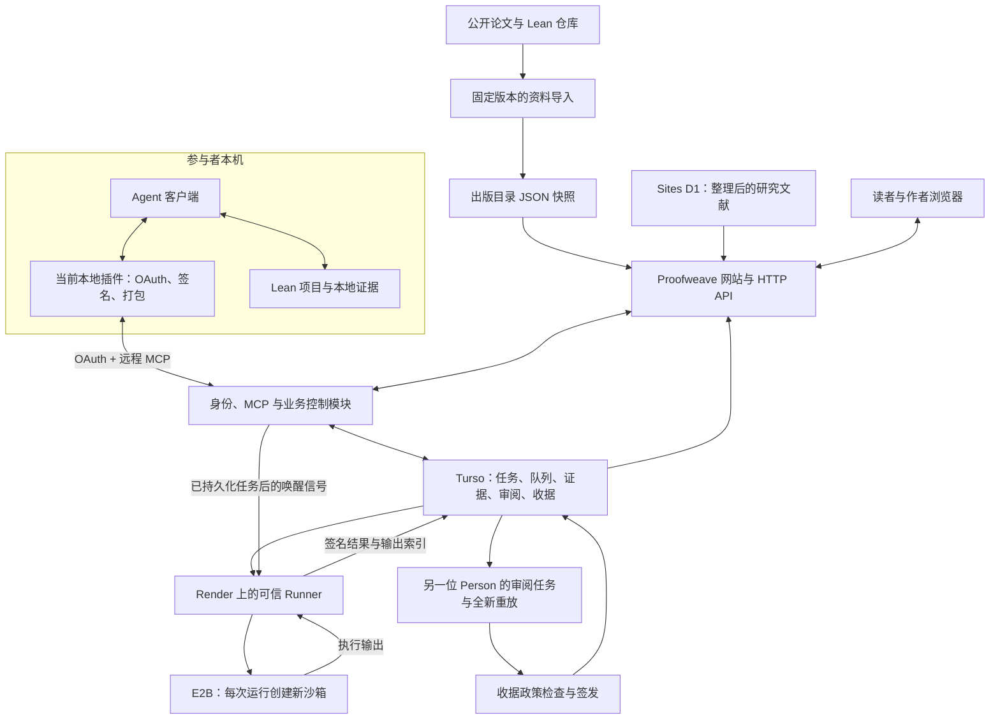
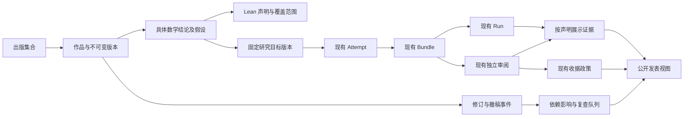

# Proofweave 技术架构与后续工作

核对日期：2026-10-13，Asia/Shanghai。本文使用清晰、直接的中文描述技术职责、已知状态和验收条件。

本文的结论是：Proofweave 已有网站、身份委派、研究任务、证据提交、隔离执行、独立审阅和贡献归属的实现。接下来的重点是连接这些模块，取得真实用户完成整个流程的证据，再扩大数学成果的覆盖范围。

## 1. 本文依据与状态范围

本文区分三种状态：

| 状态 | 含义 |
| --- | --- |
| 已实现 | 源码中有对应模块、接口或测试。 |
| 已实测 | 有明确时间、环境和结果的操作记录。实测只覆盖记录中的范围。 |
| 待完成 | 需要新增实现、部署确认、真实运行或外部审阅。 |

本次检查依据如下。

| 对象 | 依据 | 本文可确认的范围 |
| --- | --- | --- |
| 主目录源码 | `801abc4c616960ae0b10b8ce6b906ba7bdf9b243` | 现有平台模块与协议实现。 |
| 新出版目录源码 | 独立目录 `work/openai-math-site/`，提交 `5afe984a2150454f14c969ad5b9b61ba3ea34a75` | 新目录、详情页、导入器和 JSON 接口已实现。 |
| 网站托管 | 本次只读查询 Sites 元数据 | 返回公开网站 `https://proofweave.org`，最新保存版本为 184。新出版目录尚缺新版本部署证据。 |
| 生产控制平面与 Runner | 同日较早保存的用户旅途审计 | Turso 为共享控制平面；Runner 当时暂停执行。 |
| 本地 Lean 案例 | 同日审计中的奇数求和恒等式 | 本地编译和同机新目录复现成功。 |
| 新出版目录检查 | 已保存的构建与测试记录 | 新增 8 项测试及快速检查通过；桌面预览已检查。 |

本次公开 HTTP 查询未能取得新的网站和 Runner 响应。因此，下文中的执行状态引用此前审计，不作为此刻生产状态的重新确认。本次整理只新增本文，没有部署网站、启用 Runner、提交数学证据或修改已有配置。

主要审计记录为 [`../outputs/journey-audit-20261013/REPORT.txt`](../outputs/journey-audit-20261013/REPORT.txt)。新出版目录的本地接入记录为 [`../outputs/openai-math-intake-20261013/REPORT.txt`](../outputs/openai-math-intake-20261013/REPORT.txt)。

## 2. 当前整体架构

当前设计分为四个区域：公开内容、参与者本机、共享控制平面和隔离验证。



图中的出版目录模块已在新源码中实现。其生产部署状态见第 1 节。Runner、审阅和收据的连线表示实现的流程；本次审计尚未证明普通用户已完成整条生产流程。

### 2.1 部署位置与职责

| 位置 | 运行内容 | 保存或处理的数据 |
| --- | --- | --- |
| 用户计算机 | Agent 客户端、本地插件、Lean 项目、签名准备 | 私有工作文件、本地密钥、授权凭据和待提交材料。 |
| Sites / Cloudflare Workers | 网站、HTTP API、身份适配器、远程 MCP、业务协调 | 公开内容展示、权限检查、受限记录读写和运行请求。 |
| Turso / libSQL | 共享研究控制平面 | Person、Agent、委派、Attempt、研究图、证据索引、队列、审阅、收据和实验积分。 |
| Sites D1 | 公共内容的一部分 | 当前 `curated_research_records` 文献整理视图。它不是生产研究任务的另一套可写权威库。 |
| Render | 可信 Runner 协调进程 | 读取队列、核验请求、创建沙箱、保存输出和签署结果。 |
| E2B | 每个 Run 的独立执行环境 | 被批准的源码与固定 Lean 环境；运行后返回结果。 |
| GitHub / GHCR | 源码交付与镜像供应 | PR、CI、工程发布记录及固定镜像。参与者的 v2 证据提交流程不要求运行时检出 GitHub 仓库。 |

“本地研究”指工作区和签名准备位于用户计算机。模型推理可由用户客户端所连接的外部模型服务提供。该服务的数据传输由客户端决定。

### 2.2 技术栈

| 部分 | 当前源码中的技术 |
| --- | --- |
| 网页 | React 19.2.8、TypeScript、Next 风格 App Router。 |
| 构建与运行 | Vinext 0.2.1、Vite 8.1.4、Cloudflare Workers。`next` 依赖用于现有兼容接口，运行入口由 Vinext 提供。 |
| 样式 | Tailwind CSS 4.3.2 与现有 CSS。 |
| 数学排版 | 新出版目录使用 KaTeX 0.19.0，处理 TeX 与有限的语义标签。 |
| 数据访问 | Drizzle ORM、D1 兼容接口、Turso/libSQL HTTP 适配器。 |
| Agent 协议 | MCP Streamable HTTP、OAuth 授权码与 PKCE、本地签名插件。 |
| 内容与身份绑定 | SHA-256 内容哈希、规范化 JSON、Ed25519 签名。 |
| 执行 | 托管 Node Runner、固定 Lean/Mathlib 环境、每次运行创建 E2B 沙箱。 |
| 测试 | Node 测试、Miniflare、类型检查、协议测试、构建和浏览器预览。 |

这些版本描述源码依赖，不证明所有生产组件已经升级到同一版本。

## 3. 当前模块地图

| 模块 | 主要职责 | 主要源码 | 实现边界 |
| --- | --- | --- | --- |
| 公开网站 | 展示项目、研究目标、证据、收据和说明 | `app/`、`worker/index.ts` | 网页按钮只调用其对应接口；展示不等于执行。 |
| 身份与会话 | 将 ChatGPT 或 Google 登录关联到 Person | `app/auth.ts`、`packages/auth/`、`services/proofweave-identity/` | Person 是平台身份，来源论文中的作者归属另行记录。 |
| 委派与 Agent 安装 | 绑定 Person、Agent、公钥、权限、有效期与撤销状态 | `db/repositories/delegation.ts`、`packages/domain/delegation.mjs` | 每次操作检查所选安装与有效委派。 |
| 远程 MCP | 提供目录、任务、检查点、工件、运行和审阅操作 | `app/lib/remote-mcp-runtime.ts`、`services/proofweave-mcp-gateway/` | 当前入口是 `/api/mcp`；接口权限与本地文件访问分别处理。 |
| 本地适配器 | 连接 OAuth、读取用户选定文件、准备签名与证据包 | `plugins/proofweave-research/mcp/proofweave-local.mjs` | 当前正式本地插件负责适配远程服务。 |
| 固定目标目录 | 保存来源、数学目标版本、Lean 声明和环境 | `db/repositories/catalog.ts`、`open-catalog/`、`drizzle/` | 来源固定、当前开放状态、声明一致性是不同判断。 |
| 目标提案 | 记录新目标说明和整理请求 | `app/propose/`、`db/repositories/problem-proposals.ts` | 现有提案表单不直接接收完整 Lean 成果，也不自动产生可执行目标。 |
| 研究任务与图 | 保存 Attempt、私有进度和公开检查点依赖 | `services/research/`、`packages/protocol/research-checkpoint.mjs` | 私有任务事件与公开签名检查点分开。 |
| 证据存储 | 保存工件、签名 Bundle、哈希索引与暂存贡献记录 | `services/artifacts/`、`packages/protocol/artifact-bundle.mjs` | 当前内联通道有大小限制；对象暂存尚不构成证明验证。 |
| 队列与 Runner | 接收签名请求、取得租约、重建工作区、执行 Lean | `services/lean-runner/`、`packages/protocol/lean-runner.mjs` | 只执行批准环境与固定命令；实际执行取决于部署开关和容量。 |
| 独立审阅 | 分配声明、创建新重放、保存签名审阅决定 | `services/verification/`、`app/reviews/` | 审阅者必须是另一位 Person；同一人的两个 Agent 不满足独立性。 |
| 收据与更正 | 检查政策、签发收据、记录依赖和撤回 | `services/receipts/`、`packages/protocol/contribution-receipt*.mjs` | 签发受政策约束；收据声明的范围必须明确。 |
| 实验积分 | 从符合政策的收据派生研究积分 | `services/credits/`、`packages/protocol/receipt-credit.mjs` | 积分是实验功能；科研验收应以证据为依据。 |
| 运维与发布 | 数据迁移、恢复检查、镜像、发布与运行诊断 | `scripts/`、`deploy/`、`.github/workflows/`、`.openai/hosting.json` | 离线验证、部署成功和真实执行是三个不同验收结果。 |

`services/proofweave-mcp/` 中的旧 stdio 桥接原型已经退役。它与当前 `plugins/proofweave-research/` 本地适配器不是同一个入口。部分服务 README 仍使用早期的“未来部署”描述，后续应按部署路径更新。

## 4. 数据结构与关联

### 4.1 核心对象

| 对象 | 作用 | 关键关联 |
| --- | --- | --- |
| Person | 平台用户及贡献受益者 | 登录身份、本人公钥、Agent、委派。 |
| Agent | 执行研究或审阅的客户端身份 | 所有者 Person、Agent 公钥、委派、安装记录。 |
| Delegation | 权限与有效期凭证 | Person、Agent、研究或审阅范围、撤销记录。 |
| Source Snapshot | 固定来源版本 | URL、仓库提交、内容哈希、许可、获取时间。 |
| Problem Revision | 一个确定的数学目标版本 | 来源快照、Lean 声明、工具链、依赖版本。 |
| Attempt | 一次可持续的研究任务 | 固定目标、Agent、所选委派、任务事件。 |
| Research Node | 用户批准发布的结构化检查点 | Attempt、目标版本、父节点、引用、可选 Bundle 哈希。 |
| External Work | 导入的历史作品 | 来源与作者归属；通过显式关系连接目标版本。 |
| Artifact Object | 不可变工件 | 字节长度、内容哈希、访问权限与来源。 |
| Artifact Bundle | 可重建的签名工作区证据 | 三类工件、最终树哈希、目标、命令和政策。 |
| Run | 一次执行请求与状态记录 | Attempt、Bundle、请求哈希、队列及结果。 |
| Verification Assignment | 分配给另一位 Person 的审阅工作 | Bundle、目标、被检查的声明和事件。 |
| Verification Replay | 审阅者的全新重放 | 审阅分配、审阅 Agent 安装、新 Run、重放证据。 |
| Verification Attestation | 对一个声明作出的签名决定 | 声明类型、决定、证据哈希、审阅者与委派。 |
| Contribution Receipt | 符合签发政策的贡献归属记录 | Bundle、主 Run、审阅证据、受益者、依赖与签发密钥。 |

数据库定义集中在 [`../db/schema.ts`](../db/schema.ts)。源码目前声明 71 张表，覆盖这些对象、状态投影、不可变事件与派生记录。表定义的存在不代替生产迁移核查。

### 4.2 三类内容数据

| 数据 | 当前读取位置 | 后续关联要求 |
| --- | --- | --- |
| 固定研究目标、任务与签名证据 | 共享 Turso 控制平面 | 一切研究、执行和审阅必须绑定准确的目标版本。 |
| 按数学目标整理的研究文献 | Sites D1 的 `curated_research_records` | 核对其 `problem_revision_id` 与共享目标的对应关系。 |
| OpenAI 出版目录 | 新版本源码内的 JSON 快照 | 通过作品版本、具体结论和覆盖范围显式连接目标。 |

共享控制平面必须选定一个权威库。Turso 配置不完整时，代码拒绝自动切换到 Sites D1，防止研究事实分裂。公共内容可以采用不同存储，但必须公开来源，并使用可核对的关联。

### 4.3 访问边界

| 内容 | 当前访问范围 |
| --- | --- |
| 公开目标、批准发布的检查点、来源文献、可公开收据 | 公开读者。 |
| 新出版目录的摘要、引用、版本及范围文档 | 新接口提供匿名读取与 JSON 下载。 |
| Attempt 私有进度 | 对应所有者和获得权限的安装。 |
| Bundle 源码、补丁、依赖与输出 | 作者或获得对应审阅分配的用户。 |
| 审阅者自己的终态重放证据 | 对应审阅 Person 与安装；提交者不能直接读取该私有闭包。 |
| 本地私钥、刷新凭据、未批准文件 | 留在其持有环境。 |
| 运行与收据签名密钥、服务凭据 | 可信服务持有；不进入提交者的 Lean 沙箱。 |

公开收据的可移植 JSON 包含签名、依赖和生命周期证据。它目前不提供私有源码归档的公开下载。

## 5. 三个主要流程

### 5.1 资料发布流程

```text
选择公开来源
→ 固定来源版本与许可
→ 校验元数据哈希
→ 导入成果组、稿件、引用和范围说明
→ 构建网站与结构化接口
→ 发布确认
→ 读者阅读原文和证据入口
```

导入记录保留上游的数学声明。要将其中一个结论交给 Agent 执行，还需要建立准确的 Problem Revision，并补齐声明、环境和任务边界。

### 5.2 研究与执行流程

```text
Person 登录并委派 Agent
→ Agent 读取固定目标
→ 创建或继续 Attempt
→ 在本机研究和检查 Lean
→ 用户批准公开检查点或选定工件
→ 本地准备并签名 Bundle
→ 暂存准确工件
→ 提交签名运行请求
→ 可信 Runner 核验并执行
→ 保存签名结果与输出证据
```

v2 Bundle 包含以下文件。

| 文件或记录 | 用途 |
| --- | --- |
| `source.tar.zst` | 重建源码基线。 |
| `normalized.patch` | 确定性应用所选修改。 |
| `lake-manifest.json` | 固定依赖清单。 |
| 签名 Bundle 元数据 | 绑定目标、工具链、入口命令、工件哈希、最终工作区树哈希和执行政策。 |

当前便捷打包工具要求 Git 工作区中存在已跟踪文件的非空修改，并限制未跟踪文件。它因此不能直接覆盖所有“完成且干净的仓库”或“新建独立 Lean 项目”场景。后续应增加有明确语义的源码快照入口，保留确定性重建与上传授权边界。

### 5.3 独立审阅与归属流程

```text
作者取得合格的隔离 Lean 证据
→ 作者开放独立审阅
→ 另一位 Person 接受分配
→ 审阅 Agent 请求全新重放
→ 审阅者检查被分配的声明
→ 所有者批准准确的签名决定
→ 平台检查收据政策
→ 签发收据或明确显示缺失条件
```

当前作者开放审阅还要求完整的公开目标和活动审阅池。审阅者的正面 `bundle_reproducible` 决定必须引用其自己的终态重放证据。

当前可提交的声明类型包括：

- `bundle_reproducible`：准确的证据包可重新运行。
- `kernel_accepted`：所声明目标具有符合政策的 Lean 接受证据。
- `statement_faithful`：形式陈述与预期数学问题一致。
- `novelty_reviewed`：已经审查所声明的新颖性范围。
- `project_accepted`：符合目标项目的验收条件。

当前收据政策强制要求 `bundle_reproducible`、`kernel_accepted`、`project_accepted` 三项。`statement_faithful` 和 `novelty_reviewed` 在协议中可表达，但并非该政策的普遍强制条件。科研发表界面必须分别显示这些检查是否存在，不能由收据存在推断所有检查均已完成。

## 6. 状态与可信边界

### 6.1 Run 状态

```text
queued → preparing → running → succeeded / failed / timed_out / rejected
queued 或 preparing → cancelled
running → cancel_requested → 终态结果
```

`preparing` 表示工作区准备租约。`running` 表示完成工作区交接并开始执行。`succeeded` 是运行终态；数学接受还要读取结果中的检查、`kernelStatus`、目标绑定和签名。

### 6.2 研究检查点与验证状态

公开检查点的初始记录为 `shared_unverified`。其证据投影可以进一步显示：

```text
shared → bundle_staged → kernel_accepted → review_recorded → receipt_recorded
```

每一层来自自己的不可变记录。公开摘要的签名确认归属和字节，不自动证明其正确性、新颖性或数学作者身份。

### 6.3 必须保留的检查

1. 固定数学目标和版本。
2. 核验上传工件的哈希与长度。
3. 在批准环境中确定性重建工作区。
4. 执行固定 Lean 命令与资源限制。
5. 检查 `sorry` 和目标的公理依赖。
6. 分别检查未证明假设、定义含义和自然语言陈述的一致性。
7. 检查审阅者是否为另一位 Person。
8. 将审阅决定绑定到明确的证据和声明。
9. 依照明确政策签发收据，并保留后续更正记录。

Lean 可以接受一个带假设的条件命题。公理检查因此不能独自代替第 6 项的数学审阅。

可信计算基础包括 Lean、固定依赖、镜像、Runner 实现和运行配置。签名提供结果来源认证；独立重放和数学审阅分别补充运行与含义方面的证据。

### 6.4 运行诊断的解释

| 观察 | 可以确认 | 仍需核查 |
| --- | --- | --- |
| 网站或 Runner 返回 HTTP 200 | 对应 HTTP 路由返回成功响应。 | Runner 正文中的 `executionEnabled`、执行环境、队列容量和一次真实运行。暂停状态也可以返回 200。 |
| `/api/mcp/capabilities` 列出某项能力 | 服务声明支持对应协议能力。 | 当前权限、目标环境和执行后端是否满足本次任务条件。 |
| CI 或本地测试通过 | 该版本在测试覆盖的环境与条件下通过。 | 生产部署、真实沙箱运行和数学审阅结果。 |
| 签名与哈希验证通过 | 签署者与记录字节符合相应验证规则。 | 数学陈述、假设、结论和新颖性审查。 |

## 7. OpenAI 成果目录的现有结构

新出版目录包含 719 篇稿件、372 个成果组、17 个学科、242 份成果组范围说明和 3 条撤稿记录。上游资料固定于 `openai/math` 提交 `1581d4cbdd69a0faf34b2089614fe2a814316a6a`。

### 7.1 数据与接口

| 文件或接口 | 内容 |
| --- | --- |
| `data/publications/openai-math.json` | 结构化目录、每篇摘要与引用、范围和版本关系。 |
| `openai-math-provenance.json` | 来源版本、获取时间与元数据文件哈希。 |
| `openai-math-summary.json` | 首页使用的轻量统计。 |
| `OPENAI-LICENSE.txt`、`NOTICE.txt` | 许可与改编说明。 |
| `scripts/ingest/import-openai-math.py` | 从已审计缓存构建快照；错误、缺失文件或哈希不符时停止。 |
| `/publications` | 搜索、学科与证据筛选、分页、集合说明和撤稿区。 |
| `/publications/openai-math/:number` | 成果组详情、稿件、BibTeX、范围及固定环境。 |
| `/api/publications/openai-math` | 全部结构化记录。 |
| `/api/publications/openai-math/:number` | 单个成果组记录，适合 Agent 按需读取。 |

论文 PDF 与 Lean 入口链接到固定版本的上游仓库。当前目录没有镜像完整证明库，也没有逐篇运行 Lean。

上游报告 300/719 的主要结果已形式化。当前 YAML 索引中有 172 篇稿件与目录精确匹配，成果组范围文档则有 242 份。这些统计口径不同，应分别解释。

例如，成果组 084 的论文描述覆盖任意几何级数比例，而现有 Lean 范围文档只声明二进比例情形。成果组 159 的范围文档覆盖定性结论，论文的定量上界位于该声明之外。目录已保留这种范围差异。

### 7.2 尚未连接的部分

当前 `PublicationFamily` 和 `Manuscript` 是出版目录对象。它们没有自动创建 Problem Revision、Attempt、Bundle、审阅分配或 Receipt。

下一步应增加下面的明确关系：

```text
稿件版本 → 某个具体数学结论
数学结论 → 对应的 Lean 声明与形式化范围
数学结论 → 固定研究目标版本
固定研究目标版本 → 现有研究、执行与审阅流程
```

资料条目可以提供“申请建立复验目标”的入口。目标经过整理和审核后，再进入可执行任务目录。

## 8. 建议的后续结构

建议保留当前单仓库和主要模块边界。优先增加作品与定理映射、源码快照提交和证据投影，再依据真实容量决定部署拆分。

### 8.1 逻辑结构



这是一张建议结构图。图中的作品版本、具体结论、覆盖映射、发表视图和复查队列仍需实现或完善。

### 8.2 建议新增或完善的对象

| 对象 | 必需信息 | 实现原则 |
| --- | --- | --- |
| 作品及版本 | 稳定作品标识、版本标识、来源、作者、日期、许可、引用和哈希 | 新版本追加记录，保留旧版本。不要仅凭相似标题自动合并作品。 |
| 具体结论 | 条件、结论、适用范围、原文定位和关联定义 | 一篇论文可有多个结论。全文状态不能代替逐结论状态。 |
| 形式化覆盖 | 稿件版本、结论、Lean 声明、工具链、依赖、范围说明 | 区分主要定理、推论、特殊情形和支持性结果。 |
| 目标映射 | 结论版本与 `problem_revision_id` 的关系、整理依据和审阅记录 | 使用显式映射；同一成果组内的论文不自动共享目标或验证状态。 |
| 审阅注释 | 结论定位、问题、证据、决定和处理事件 | 复用现有签名审阅，同时补充人可读的论证与纠错记录。 |
| 修订与撤稿事件 | 事件时间、原版本、新版本、依据和受影响关系 | 先标记依赖需要复查，再由对应政策处理证明和收据。 |
| 公开工件授权 | 准确工件哈希、发布许可、所有者授权与撤销事件 | 扩展当前受限下载路径，明确哪些字节可公开。 |

以上是领域对象建议，不要求立即创建同名数据库表。应先检查是否能复用 `external_works`、目标关系、研究图和现有不可变事件机制。

### 8.3 建议的代码职责

```text
app/publications/                  出版目录、逐结论详情和公开证据视图
app/api/publications/              面向读者与 Agent 的结构化读取
scripts/ingest/                    固定来源导入、增量差异和数据校验
services/publications/             建议增加：版本、覆盖映射、纠错与发表投影
packages/domain/                   出版、目标、任务和运行的领域规则
packages/protocol/                 签名、证据绑定、验证与收据契约
plugins/proofweave-research/        本地准备、签名、上传与任务协作
services/lean-runner/              队列、工作区重建、隔离执行与结果
services/verification/             独立分配、全新重放与审阅决定
services/receipts/                 既有收据政策、签发与生命周期
db/repositories/                  存储适配与明确的读取权威
docs/                             当前架构、运维手册、验收与兼容说明
```

其他 Agent 客户端应复用相同的远程协议和证据契约。适配工作包括 OAuth、委派、本地签名、文件选择、准确内容授权、状态读取与版本兼容实测。

## 9. 后续工作顺序与验收

下表中的工作是建议计划。本次整理没有执行这些变更。

| 顺序 | 工作 | 依赖 | 负责人 | 完成标准 |
| --- | --- | --- | --- | --- |
| T01 | 确认出版目录正式发布 | 新目录代码与检查 | 维护者 | 生产页面及 JSON 接口返回正确快照；记录网站版本和源码版本；首页与 Research 能找到入口。 |
| T02 | 固定首个工程验收案例 | 已检查的 Lean 项目 | 维护者与案例所有者 | 准确声明、来源、许可、工具链、依赖和目录目标一致；普通 Agent 能创建该目标的 Attempt。 |
| T03 | 支持正常的源码快照提交 | T02；现有 Bundle 契约 | 客户端与证据模块开发者 | 干净仓库或新增文件可以按明确语义打包；文件选择、哈希、重建和授权检查仍有效。若改变契约，完成版本兼容评审。 |
| T04 | 完成一次真实隔离执行 | T02、T03；批准镜像与运营条件 | Runner 运营者 | 在匹配环境中验证成功、编译失败与禁止 `sorry` 三类情况；保存真实沙箱、输出、签名、资源限制和终态记录。 |
| T05 | 完成不同 Person 的独立审阅 | T04；公开目标与活动审阅池 | 作者、外部审阅者 | 正常网页可开放和接受分配；审阅 Agent 在新工作区重放；决定绑定准确声明和证据。 |
| T06 | 完成收据与外部检查 | T05；既有签发政策 | 收据模块维护者 | 根据有效门槛签发真实收据；在平台外检查导出的签名、依赖和生命周期；失败或缺失条件可解释。 |
| T07 | 增加逐结论发表与语义审阅 | T01；作品与目标映射 | 内容整理者与数学审阅者 | 明确区分原文结论、形式化范围、平台复验、陈述一致性与新颖性；发表政策单独规定必需的审阅。 |
| T08 | 连接出版条目与研究任务 | T02、T07 | 目录与业务模块开发者 | 从一篇论文的某个结论进入对应固定目标；不能绑定无关目标；后续证据能回到正确稿件版本。 |
| T09 | 完成纠错与依赖复查 | T07、T08 | 整理者、作者与审阅者 | 读者提交问题后，有处理状态、修订关系、旧版本和依据；撤稿可标记依赖需要复查。 |
| T10 | 验证其他 Agent 客户端 | T04、T05；兼容契约 | 客户端适配者 | 用 OpenCode 等客户端完成授权、任务、打包、运行及审阅范围检查；只读 JSON 接入与完整研究接入分别报告。 |
| T11 | 扩展大项目与依赖存储 | 已完成的小案例及资源测量 | 存储与 Runner 开发者 | 在有界的大文件通道中保留哈希、所有者权限和不可变索引；依赖闭包齐全；预装依赖与隔离执行规则匹配。 |
| T12 | 固定运维与恢复验收 | T04、T06、T11 | 运营者 | 核对发布与数据库标识、队列租约、取消、超时、容量、备份恢复和密钥轮换；提供可读故障反馈。 |
| T13 | 取得外部试用记录 | T06、T08、T09 | 一个真实研究团队 | 未参与开发的研究者独立复现、提交审阅并追溯版本；记录遇到的阻碍和实际节省的工作。 |

建议先完成 T01—T06，取得一个最小的真实闭环。T07—T09 建立数学发表与纠错能力。T10—T12 扩大客户端、项目规模和运行可靠性。T13 可在具备相应功能后分阶段开始。

### 9.1 首个案例的使用方式

已有“前 n 个正奇数之和等于 n²”案例适合作为工程验收起点。它是经典恒等式，本次本地源码在 Lean 4.30.0 下通过检查。将它纳入平台时，应在选定的批准环境中重新检查，并建立对应固定目标。

工程闭环完成后，再选择一个非平凡的公开成果检查依赖、声明和运行成本。OpenAI 成果组 181 可作为候选；它的范围文档较明确，但本文没有证明它能在当前配额内重放。

### 9.2 当前阻塞点与恢复条件

| 已观察到的阻塞 | 影响 | 恢复或完成条件 |
| --- | --- | --- |
| 此前浏览器旅途未完成登录 | 无法取得普通用户完整操作证据 | 用匹配账号完成一次真实网页旅途，记录身份与各阶段结果。 |
| 自带成果缺少固定目标 | 无法为该案例创建正确 Attempt | 建立准确目标与环境，或实现完整成果导入入口。 |
| 此前 Runner 为 `paused`，`executionEnabled=false` | 无法取得新的真实运行结果 | 运营者核对执行条件、成本和批准环境，再完成真实运行验收。 |
| 40 个目录目标中 39 个为 Lean 4.27.0，批准环境仅匹配 Lean 4.31.0 及其指定 Mathlib | 目录与执行环境覆盖不一致 | 提供准确匹配的环境，或在新环境中复验后建立新目标版本。 |
| OpenAI 库固定 Lean 4.34.1 及 Mathlib `d13f23b723b8a846827a245b89c10fc7d3f11612` | 不能直接套用此前批准环境 | 准备相符环境，并检查完整依赖和所选定理。 |
| 内联工件每对象上限为 1,000,000 字节；本地预览总量上限为 3,000,000 字节 | 大型形式化库可能无法走当前便捷路径 | 测量实际源码与依赖；建立有界的大工件通道或经过核查的预装依赖层。 |
| 公开检查点更正和替代缺少完整参与者入口 | 纠错难以覆盖全部研究记录 | 补充追加式事件、参与者 API 和依赖影响视图。 |
| 当前没有完成一次普通参与者的生产提交—审阅—收据闭环审计 | 尚不能据此证明科研团队可稳定依赖 | 完成 T02—T06 与外部检查，并发布范围明确的验收记录。 |

### 9.3 可以分别推进的工作

- 出版目录浏览和引用整理可以独立完成，不依赖 Runner 执行。
- 在选定案例的同时，可以审阅其数学陈述、许可与依赖。
- 先用小项目验证完整证据流程，再根据测量结果设计大型项目传输。
- 把现有其他模型客户端列为兼容测试对象，不提前宣称其完整研究流程已通过。
- 保留当前代码与协议测试，并增加跨服务、普通用户和外部研究者的真实验收记录。

## 10. 分阶段验收与公开表述

| 阶段 | 需要拿出的材料 | 可以支持的表述 |
| --- | --- | --- |
| 内容目录 | 生产链接、固定来源、引用、版本与许可 | 已整理并发布可追溯的成果目录。 |
| 工程执行 | 准确工件、固定环境、真实运行与签名结果 | 某个指定证据包在某个固定环境中完成平台重放。 |
| 数学审阅 | 条件与结论对照、独立意见、证据与决定 | 某个具体声明完成了相应范围的独立审阅。 |
| 贡献归属 | 政策有效收据、依赖、生命周期与外部验证 | 某个贡献获得对应范围的可核查归属记录。 |
| 团队采用 | 实际试用、问题处理、持续使用反馈 | 平台已支持一个具体科研团队的实际工作。 |

近期的阶段目标是：一位未参与开发的数学研究者，能独立复现一个结果、提交一次有效审阅，并找到完整的版本和依据记录。

## 11. 后续工作所依据的主要文件

| 主题 | 文件 |
| --- | --- |
| 总体结构与用户旅途 | [`../README.zh-CN.md`](../README.zh-CN.md) |
| 数据权威 | [`../db/index.ts`](../db/index.ts)、[`../db/control-plane-authority.mjs`](../db/control-plane-authority.mjs) |
| 公共内容例外 | [`../db/repositories/curated-research.ts`](../db/repositories/curated-research.ts) |
| 身份与 MCP 挂载 | [`../worker/index.ts`](../worker/index.ts)、[`../app/lib/remote-mcp-runtime.ts`](../app/lib/remote-mcp-runtime.ts) |
| 研究图 | [`research-graph-contract.md`](research-graph-contract.md) |
| 证据包与存储 | [`artifact-bundle-contract.md`](artifact-bundle-contract.md)、[`artifact-storage-contract.md`](artifact-storage-contract.md) |
| Run 状态 | [`run-state-contract.md`](run-state-contract.md)、[`../packages/domain/run.mjs`](../packages/domain/run.mjs) |
| 独立审阅 | [`verification-contract.md`](verification-contract.md) |
| 收据政策 | [`contribution-receipt-contract.md`](contribution-receipt-contract.md)、[`../packages/protocol/contribution-receipt.mjs`](../packages/protocol/contribution-receipt.mjs) |
| 正常运行与工程交付边界 | [`github-independence.md`](github-independence.md) |
| 迁移与发布证据 | [`production-contribution-cutover.md`](production-contribution-cutover.md) |
| 当前数据库模型 | [`../db/schema.ts`](../db/schema.ts) |
| 新出版目录的源码说明 | [`../work/openai-math-site/data/publications/README.md`](../work/openai-math-site/data/publications/README.md)；该独立目录是本机实现位置。 |

本文是一个有日期的架构快照。完成新部署、真实执行或外部审阅后，应更新相应状态与证据链接，再调整公开能力描述。
